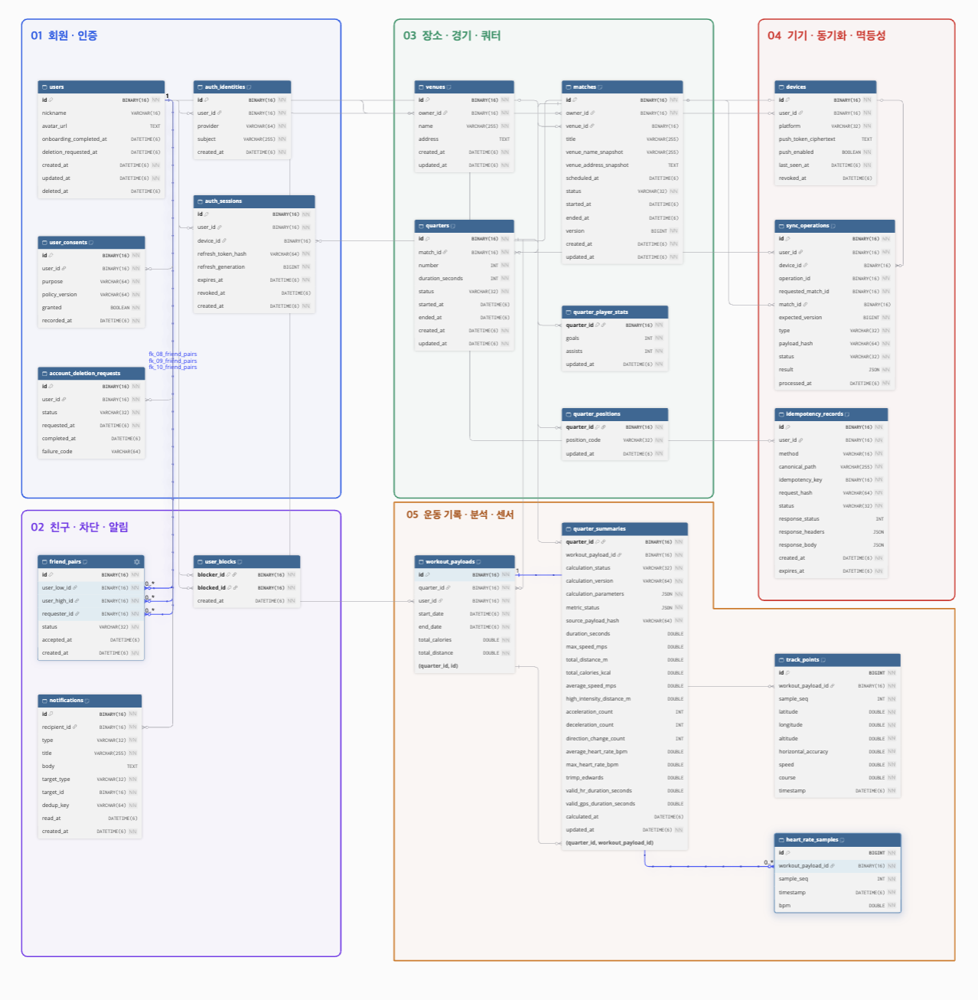

# KIIKICK 쿼터 중심 ERD

**v0.4 · 2026-11-02 · 개인 기록 설계**

기준 물리 정의는 [full-design.sql](dbdiagram/full-design.sql)과 [full-design.dbml](dbdiagram/full-design.dbml)이다. 컬럼 사전은 해당 SQL의 26개 테이블·33개 FK를 반영한다. 전체 ERD 이미지는 사용자가 제공한 dbdiagram 화면을 사용한다. 운영 DB나 현재 PR에 적용된 스키마라는 의미는 아니다.

## 1. 모델 원칙

쿼터가 운동·개인 기록의 중심이다. matches는 본인 쿼터의 날짜·장소 묶음이며 quarters.match_id가 이를 가리킨다. 사용자 → 개인 경기 → 쿼터 → 직접 입력 기록/포지션/운동 원본/요약으로 연결한다. 친구 관계는 경기 소유권을 공유하지 않는다.

개별 득점 시점·팀 점수·참가자 관계·경기 전체 결과 집계/발행 대기 모델은 사용하지 않는다. 경기 합계는 쿼터별 골·어시스트를 합산하고, 운동 지표는 저장된 쿼터 요약을 사용한다.

## 2. 전체 ERD

[원본 이미지 보기](images/kiikick-erd.png) · 최신 컬럼 정의는 아래 사전과 SQL·DBML을 기준으로 확인한다. 이미지에는 Edwards 계산 기준인 `hr_max_reference_bpm` 컬럼이 표시되어 있지 않다.

## 3. 테이블·컬럼 사전

### users

개인 기록 소유자. 프로필·온보딩·삭제 요청 상태.

| 컬럼 | SQL 타입 | null | 키 |
| --- | --- | --- | --- |
| id | BINARY(16) | NOT NULL | PK |
| nickname | VARCHAR(16) | NULL |  |
| avatar_url | TEXT | NULL |  |
| onboarding_completed_at | DATETIME(6) | NULL |  |
| deletion_requested_at | DATETIME(6) | NULL |  |
| created_at | DATETIME(6) | NOT NULL |  |
| updated_at | DATETIME(6) | NOT NULL |  |
| deleted_at | DATETIME(6) | NULL |  |

인덱스: `PRIMARY KEY (`id`)`.

### auth_identities

외부 인증 제공자 계정 연결. provider/subject 고유.

| 컬럼 | SQL 타입 | null | 키 |
| --- | --- | --- | --- |
| id | BINARY(16) | NOT NULL | PK |
| user_id | BINARY(16) | NOT NULL |  |
| provider | VARCHAR(64) | NOT NULL |  |
| subject | VARCHAR(255) | NOT NULL |  |
| created_at | DATETIME(6) | NOT NULL |  |

인덱스: `PRIMARY KEY (`id`)`; `UNIQUE KEY `uk_identity_provider_subject` (`provider`, `subject`)`.

### email_credentials

이메일·비밀번호 로그인 Credential. 정규화 이메일을 서비스 식별자로 사용한다.

| 컬럼 | SQL 타입 | null | 키 |
| --- | --- | --- | --- |
| user_id | BINARY(16) | NOT NULL | PK |
| email | VARCHAR(320) | NOT NULL |  |
| normalized_email | VARCHAR(320) | NOT NULL | UNIQUE |
| password_hash | VARCHAR(100) | NOT NULL |  |
| email_verified_at | DATETIME(6) | NOT NULL |  |
| password_changed_at | DATETIME(6) | NOT NULL |  |
| created_at | DATETIME(6) | NOT NULL |  |
| updated_at | DATETIME(6) | NOT NULL |  |

### email_verification_flows

가입·재설정 이메일 인증과 검증 후 일회용 Action Token 상태. 코드 원문 대신 용도별 HMAC-SHA-256, Action Token 원문 대신 SHA-256 해시를 저장한다.

| 컬럼 | SQL 타입 | null | 키 |
| --- | --- | --- | --- |
| id | BINARY(16) | NOT NULL | PK |
| normalized_email | VARCHAR(320) | NOT NULL |  |
| purpose | VARCHAR(32) | NOT NULL |  |
| code_hash | CHAR(64) | NULL |  |
| failed_attempts | INT | NOT NULL |  |
| code_expires_at | DATETIME(6) | NOT NULL |  |
| last_sent_at | DATETIME(6) | NOT NULL |  |
| verified_at | DATETIME(6) | NULL |  |
| invalidated_at | DATETIME(6) | NULL |  |
| action_token_hash | CHAR(64) | NULL | UNIQUE |
| action_token_expires_at | DATETIME(6) | NULL |  |
| action_token_consumed_at | DATETIME(6) | NULL |  |
| created_at | DATETIME(6) | NOT NULL |  |
| updated_at | DATETIME(6) | NOT NULL |  |

### auth_rate_limit_keys

이메일·IP별 발송 제한을 직렬화하기 위한 잠금 키. IP는 원문 대신 별도 HMAC을 사용한다.

| 컬럼 | SQL 타입 | null | 키 |
| --- | --- | --- | --- |
| rate_action | VARCHAR(64) | NOT NULL | PK |
| limit_type | VARCHAR(16) | NOT NULL | PK |
| key_value | VARCHAR(320) | NOT NULL | PK |
| created_at | DATETIME(6) | NOT NULL |  |

### auth_rate_limit_events

최근 24시간·1분의 슬라이딩 발송 횟수를 계산하는 성공 이벤트.

| 컬럼 | SQL 타입 | null | 키 |
| --- | --- | --- | --- |
| id | BINARY(16) | NOT NULL | PK |
| rate_action | VARCHAR(64) | NOT NULL |  |
| limit_type | VARCHAR(16) | NOT NULL |  |
| key_value | VARCHAR(320) | NOT NULL |  |
| occurred_at | DATETIME(6) | NOT NULL |  |

### user_consents

목적별 동의 이력. 현재 동의는 recorded_at/id의 최신 행에서 파생.

| 컬럼 | SQL 타입 | null | 키 |
| --- | --- | --- | --- |
| id | BINARY(16) | NOT NULL | PK |
| user_id | BINARY(16) | NOT NULL |  |
| purpose | VARCHAR(64) | NOT NULL |  |
| policy_version | VARCHAR(64) | NOT NULL |  |
| granted | BOOLEAN | NOT NULL |  |
| recorded_at | DATETIME(6) | NOT NULL |  |

인덱스: `PRIMARY KEY (`id`)`; `KEY `idx_consent_current` (`user_id`, `purpose`, `recorded_at`, `id`)`.

### venues

사용자 개인 경기장 목록. 경기 선택 시 이름·주소 사본을 저장한다. `corner_*`는 보정 좌표, `raw_corner_*`는 사용자 원본 핀으로 별도 보존한다. 기존 좌표 없는 경기장은 NULL이며 좌표 검증과 보정 코너 4개 동시 변경은 API에서 처리한다.

| 컬럼 | SQL 타입 | null | 키 |
| --- | --- | --- | --- |
| id | BINARY(16) | NOT NULL | PK |
| owner_id | BINARY(16) | NOT NULL |  |
| name | VARCHAR(255) | NOT NULL |  |
| address | TEXT | NULL |  |
| corner_a_latitude | DOUBLE | NULL |  |
| corner_a_longitude | DOUBLE | NULL |  |
| corner_b_latitude | DOUBLE | NULL |  |
| corner_b_longitude | DOUBLE | NULL |  |
| corner_c_latitude | DOUBLE | NULL |  |
| corner_c_longitude | DOUBLE | NULL |  |
| corner_d_latitude | DOUBLE | NULL |  |
| corner_d_longitude | DOUBLE | NULL |  |
| raw_corner_a_latitude | DOUBLE | NULL |  |
| raw_corner_a_longitude | DOUBLE | NULL |  |
| raw_corner_b_latitude | DOUBLE | NULL |  |
| raw_corner_b_longitude | DOUBLE | NULL |  |
| raw_corner_c_latitude | DOUBLE | NULL |  |
| raw_corner_c_longitude | DOUBLE | NULL |  |
| raw_corner_d_latitude | DOUBLE | NULL |  |
| raw_corner_d_longitude | DOUBLE | NULL |  |
| created_at | DATETIME(6) | NOT NULL |  |
| updated_at | DATETIME(6) | NOT NULL |  |

인덱스: `PRIMARY KEY (`id`)`; `KEY `idx_venue_owner` (`owner_id`, `updated_at`, `id`)`.

### matches

날짜·장소를 공유하는 본인 쿼터 묶음. owner_id는 유일한 기록 대상. version은 모든 하위 변경의 동시성 범위.

| 컬럼 | SQL 타입 | null | 키 |
| --- | --- | --- | --- |
| id | BINARY(16) | NOT NULL | PK |
| owner_id | BINARY(16) | NOT NULL |  |
| venue_id | BINARY(16) | NULL |  |
| title | VARCHAR(255) | NULL |  |
| venue_name_snapshot | VARCHAR(255) | NULL |  |
| venue_address_snapshot | TEXT | NULL |  |
| scheduled_at | DATETIME(6) | NULL |  |
| status | VARCHAR(32) | NOT NULL |  |
| started_at | DATETIME(6) | NULL |  |
| ended_at | DATETIME(6) | NULL |  |
| version | BIGINT | NOT NULL |  |
| created_at | DATETIME(6) | NOT NULL |  |
| updated_at | DATETIME(6) | NOT NULL |  |

인덱스: `PRIMARY KEY (`id`)`; `KEY `idx_match_owner_status` (`owner_id`, `status`, `scheduled_at`, `id`)`; `KEY `idx_match_completed` (`status`, `ended_at`, `id`)`.

### quarters

운동·골·어시스트·포지션의 중심 기록 단위. duration_seconds는 설정 시간. ended_at으로 측정 마감 상태를 구별.

| 컬럼 | SQL 타입 | null | 키 |
| --- | --- | --- | --- |
| id | BINARY(16) | NOT NULL | PK |
| match_id | BINARY(16) | NOT NULL |  |
| number | INT | NOT NULL |  |
| duration_seconds | INT | NOT NULL |  |
| status | VARCHAR(32) | NOT NULL |  |
| started_at | DATETIME(6) | NULL |  |
| ended_at | DATETIME(6) | NULL |  |
| created_at | DATETIME(6) | NOT NULL |  |
| updated_at | DATETIME(6) | NOT NULL |  |

인덱스: `PRIMARY KEY (`id`)`; `UNIQUE KEY `uk_quarter_number` (`match_id`, `number`)`; `KEY `idx_quarter_status` (`match_id`, `status`, `number`)`.

### quarter_player_stats

쿼터별 직접 입력 골·어시스트 원본 합계. 행 없음과 명시적 0 입력을 구별.

| 컬럼 | SQL 타입 | null | 키 |
| --- | --- | --- | --- |
| quarter_id | BINARY(16) | NOT NULL | PK |
| goals | INT | NOT NULL |  |
| assists | INT | NOT NULL |  |
| updated_at | DATETIME(6) | NOT NULL |  |

인덱스: `PRIMARY KEY (`quarter_id`)`.

### quarter_positions

쿼터별 대표 포지션 하나. 소유자는 경기 연결에서 확인.

| 컬럼 | SQL 타입 | null | 키 |
| --- | --- | --- | --- |
| quarter_id | BINARY(16) | NOT NULL | PK |
| position_code | VARCHAR(32) | NOT NULL |  |
| updated_at | DATETIME(6) | NOT NULL |  |

인덱스: `PRIMARY KEY (`quarter_id`)`.

### quarter_summaries

쿼터별 운동 조회용 파생 요약. 상태·기준·버전·해시를 저장하고 원본은 별도 유지.

| 컬럼 | SQL 타입 | null | 키 |
| --- | --- | --- | --- |
| quarter_id | BINARY(16) | NOT NULL | PK |
| workout_payload_id | BINARY(16) | NOT NULL |  |
| calculation_job_id | BINARY(16) | NOT NULL |  |
| calculation_status | VARCHAR(32) | NOT NULL |  |
| calculation_version | VARCHAR(64) | NOT NULL |  |
| calculation_parameters | JSON | NOT NULL |  |
| metric_status | JSON | NOT NULL |  |
| source_payload_hash | VARCHAR(64) | NOT NULL |  |
| duration_seconds | DOUBLE | NULL |  |
| max_speed_mps | DOUBLE | NULL |  |
| total_distance_m | DOUBLE | NULL |  |
| total_calories_kcal | DOUBLE | NULL |  |
| average_speed_mps | DOUBLE | NULL |  |
| high_intensity_distance_m | DOUBLE | NULL |  |
| acceleration_count | INT | NULL |  |
| deceleration_count | INT | NULL |  |
| direction_change_count | INT | NULL |  |
| average_heart_rate_bpm | DOUBLE | NULL |  |
| max_heart_rate_bpm | DOUBLE | NULL |  |
| trimp_edwards | DOUBLE | NULL |  |
| hr_max_reference_bpm | DOUBLE | NULL |  |
| valid_hr_duration_seconds | DOUBLE | NULL |  |
| valid_gps_duration_seconds | DOUBLE | NULL |  |
| calculated_at | DATETIME(6) | NULL |  |
| updated_at | DATETIME(6) | NOT NULL |  |

인덱스: `PRIMARY KEY (`quarter_id`)`.

### friend_pairs

방향 없는 친구 쌍. 낮은 ID/높은 ID로 정규화하고 requester_id로 요청 방향을 저장.

| 컬럼 | SQL 타입 | null | 키 |
| --- | --- | --- | --- |
| id | BINARY(16) | NOT NULL | PK |
| user_low_id | BINARY(16) | NOT NULL |  |
| user_high_id | BINARY(16) | NOT NULL |  |
| requester_id | BINARY(16) | NOT NULL |  |
| status | VARCHAR(32) | NOT NULL |  |
| accepted_at | DATETIME(6) | NULL |  |
| created_at | DATETIME(6) | NOT NULL |  |

인덱스: `PRIMARY KEY (`id`)`; `UNIQUE KEY `uk_friend_pair` (`user_low_id`, `user_high_id`)`.

### user_blocks

방향 있는 차단 관계.

| 컬럼 | SQL 타입 | null | 키 |
| --- | --- | --- | --- |
| blocker_id | BINARY(16) | NOT NULL | PK |
| blocked_id | BINARY(16) | NOT NULL | PK |
| created_at | DATETIME(6) | NOT NULL |  |

인덱스: `PRIMARY KEY (`blocker_id`, `blocked_id`)`; `KEY `idx_block_reverse` (`blocked_id`, `blocker_id`)`.

### notifications

본인 수신 알림. target_type/target_id는 이동 힌트이며 현재 권한을 다시 확인.

| 컬럼 | SQL 타입 | null | 키 |
| --- | --- | --- | --- |
| id | BINARY(16) | NOT NULL | PK |
| recipient_id | BINARY(16) | NOT NULL |  |
| type | VARCHAR(32) | NOT NULL |  |
| title | VARCHAR(255) | NOT NULL |  |
| body | TEXT | NULL |  |
| target_type | VARCHAR(32) | NOT NULL |  |
| target_id | BINARY(16) | NOT NULL |  |
| dedup_key | VARCHAR(64) | NOT NULL |  |
| read_at | DATETIME(6) | NULL |  |
| created_at | DATETIME(6) | NOT NULL |  |

인덱스: `PRIMARY KEY (`id`)`; `UNIQUE KEY `uk_notification_dedup` (`dedup_key`)`; `KEY `idx_notification_list` (`recipient_id`, `created_at`, `id`)`; `KEY `idx_notification_unread` (`recipient_id`, `read_at`)`.

### auth_sessions

로그인 세션·갱신 토큰 해시·회전 세대. created_at은 최초 발급 시각, expires_at은 연장하지 않는 90일 절대 만료다.

| 컬럼 | SQL 타입 | null | 키 |
| --- | --- | --- | --- |
| id | BINARY(16) | NOT NULL | PK |
| user_id | BINARY(16) | NOT NULL |  |
| device_id | BINARY(16) | NULL |  |
| refresh_token_hash | VARCHAR(64) | NOT NULL |  |
| refresh_generation | BIGINT | NOT NULL |  |
| expires_at | DATETIME(6) | NOT NULL |  |
| revoked_at | DATETIME(6) | NULL |  |
| created_at | DATETIME(6) | NOT NULL |  |

인덱스: PK(id), idx_auth_sessions_refresh_hash(refresh_token_hash).

### auth_refresh_token_history (#62)

| 컬럼 | SQL 타입 | null | 키 |
| --- | --- | --- | --- |
| token_hash | VARCHAR(64) | NOT NULL | PK, 소비된 SHA-256 해시 |
| session_id | BINARY(16) | NOT NULL | FK → auth_sessions.id |
| generation | BIGINT | NOT NULL | 세대, 0 이상 |
| consumed_at | DATETIME(6) | NOT NULL | UTC 소비 시각 |
| expires_at | DATETIME(6) | NOT NULL | 세션 절대 만료 |

UNIQUE(session_id, generation), INDEX(expires_at), CHECK(consumed_at < expires_at).
Grace 없이 재사용을 탐지하며 세션 절대 만료까지 보존한다. 만료 후 시간 단위로 정리한다.

#62 추가 승인(2026-11-06): 앱 내부 `@EnableScheduling`을 사용하고 시작 1시간 후부터 이전 정리 완료 기준 1시간 간격으로 실행한다. `expires_at <= UTC 현재 시각`만 삭제하며 실패는 기록 후 다음 주기에 재시도한다. 여러 인스턴스의 중복 삭제는 멱등적이지만 DB 잠금·공용 커넥션 풀의 성능 경합까지 제거하는 것은 아니다. 별도 배치 시스템은 도입하지 않는다.

원문·복호화 가능한 토큰은 저장하지 않는다. V003은 V002 이후 적용하며 기존 만료일을 변경하지 않는다.

### devices

사용자 기기 및 푸시 상태. 원문 푸시 토큰 대신 암호화 값 보관.

| 컬럼 | SQL 타입 | null | 키 |
| --- | --- | --- | --- |
| id | BINARY(16) | NOT NULL | PK |
| user_id | BINARY(16) | NOT NULL |  |
| platform | VARCHAR(32) | NOT NULL |  |
| push_token_ciphertext | TEXT | NULL |  |
| push_enabled | BOOLEAN | NOT NULL |  |
| last_seen_at | DATETIME(6) | NOT NULL |  |
| revoked_at | DATETIME(6) | NULL |  |

인덱스: `PRIMARY KEY (`id`)`.

### account_deletion_requests

탈퇴 비동기 처리 상태. 데이터 보존·삭제 범위는 P11.

| 컬럼 | SQL 타입 | null | 키 |
| --- | --- | --- | --- |
| id | BINARY(16) | NOT NULL | PK |
| user_id | BINARY(16) | NOT NULL |  |
| status | VARCHAR(32) | NOT NULL |  |
| requested_at | DATETIME(6) | NOT NULL |  |
| completed_at | DATETIME(6) | NULL |  |
| failure_code | VARCHAR(64) | NULL |  |

인덱스: `PRIMARY KEY (`id`)`.

### idempotency_records

HTTP 변경 요청 재전송 결과. 사용자/메서드/경로/키 범위.

| 컬럼 | SQL 타입 | null | 키 |
| --- | --- | --- | --- |
| id | BINARY(16) | NOT NULL | PK |
| user_id | BINARY(16) | NOT NULL |  |
| method | VARCHAR(16) | NOT NULL |  |
| canonical_path | VARCHAR(255) | NOT NULL |  |
| idempotency_key | BINARY(16) | NOT NULL |  |
| request_hash | VARCHAR(64) | NOT NULL |  |
| status | VARCHAR(32) | NOT NULL |  |
| response_status | INT | NULL |  |
| response_headers | JSON | NULL |  |
| response_body | JSON | NULL |  |
| created_at | DATETIME(6) | NOT NULL |  |
| expires_at | DATETIME(6) | NOT NULL |  |

인덱스: `PRIMARY KEY (`id`)`; `UNIQUE KEY `uk_idempotency_scope` (`user_id`, `method`, `canonical_path`, `idempotency_key`)`; `KEY `idx_idempotency_expiry` (`expires_at`)`.

### sync_operations

선택적 오프라인 조작 명령과 결과. 센서 원본 파일 저장 테이블과 다름.

| 컬럼 | SQL 타입 | null | 키 |
| --- | --- | --- | --- |
| id | BINARY(16) | NOT NULL | PK |
| user_id | BINARY(16) | NOT NULL |  |
| device_id | BINARY(16) | NULL |  |
| operation_id | BINARY(16) | NOT NULL |  |
| requested_match_id | BINARY(16) | NOT NULL |  |
| match_id | BINARY(16) | NULL |  |
| expected_version | BIGINT | NOT NULL |  |
| type | VARCHAR(32) | NOT NULL |  |
| payload_hash | VARCHAR(64) | NOT NULL |  |
| status | VARCHAR(32) | NOT NULL |  |
| result | JSON | NOT NULL |  |
| processed_at | DATETIME(6) | NOT NULL |  |

인덱스: `PRIMARY KEY (`id`)`; `UNIQUE KEY `uk_sync_operation` (`user_id`, `operation_id`)`.

### workout_payloads

쿼터당 운동 원본 한 건. 개인 거리·칼로리와 측정 시작/종료. user_id는 연결된 경기 owner_id와 같아야 함.

| 컬럼 | SQL 타입 | null | 키 |
| --- | --- | --- | --- |
| id | BINARY(16) | NOT NULL | PK |
| quarter_id | BINARY(16) | NOT NULL |  |
| user_id | BINARY(16) | NOT NULL |  |
| start_date | DATETIME(6) | NOT NULL |  |
| end_date | DATETIME(6) | NOT NULL |  |
| total_calories | DOUBLE | NOT NULL |  |
| total_distance | DOUBLE | NOT NULL |  |
| events_json | JSON | NULL |  |
| field_snapshot | JSON | NULL |  |

인덱스: `PRIMARY KEY (`id`)`; `UNIQUE KEY `uk_workout_quarter` (`quarter_id`)`; `UNIQUE KEY `uk_workout_quarter_id` (`quarter_id`, `id`)`; `KEY `idx_workout_user_start` (`user_id`, `start_date`)`.

### track_points

GPS 원본 전체. 각 배열의 0부터 시작하는 sample_seq를 유지.

| 컬럼 | SQL 타입 | null | 키 |
| --- | --- | --- | --- |
| id | BIGINT | NOT NULL | PK |
| workout_payload_id | BINARY(16) | NOT NULL |  |
| sample_seq | INT | NOT NULL |  |
| latitude | DOUBLE | NOT NULL |  |
| longitude | DOUBLE | NOT NULL |  |
| altitude | DOUBLE | NOT NULL |  |
| horizontal_accuracy | DOUBLE | NOT NULL |  |
| speed | DOUBLE | NOT NULL |  |
| course | DOUBLE | NOT NULL |  |
| timestamp | DATETIME(6) | NOT NULL |  |

인덱스: `PRIMARY KEY (`id`)`; `UNIQUE KEY `uk_track_payload_seq` (`workout_payload_id`, `sample_seq`)`.

### heart_rate_samples

특정 시각의 심박 측정 원본 전체. sample은 예시 데이터라는 뜻이 아님.

| 컬럼 | SQL 타입 | null | 키 |
| --- | --- | --- | --- |
| id | BIGINT | NOT NULL | PK |
| workout_payload_id | BINARY(16) | NOT NULL |  |
| sample_seq | INT | NOT NULL |  |
| timestamp | DATETIME(6) | NOT NULL |  |
| bpm | DOUBLE | NOT NULL |  |

인덱스: `PRIMARY KEY (`id`)`; `UNIQUE KEY `uk_heart_payload_seq` (`workout_payload_id`, `sample_seq`)`.

## 4. 외래키와 삭제 동작

| FK | 자식 | 부모 | ON DELETE |
| --- | --- | --- | --- |
| fk_01_auth_identities | auth_identities.(user_id) | users.(id) | RESTRICT |
| fk_email_credentials_user | email_credentials.(user_id) | users.(id) | RESTRICT |
| fk_auth_rate_limit_events_key | auth_rate_limit_events.(rate_action, limit_type, key_value) | auth_rate_limit_keys.(rate_action, limit_type, key_value) | RESTRICT |
| fk_02_user_consents | user_consents.(user_id) | users.(id) | RESTRICT |
| fk_03_venues | venues.(owner_id) | users.(id) | RESTRICT |
| fk_04_matches | matches.(owner_id) | users.(id) | RESTRICT |
| fk_08_friend_pairs | friend_pairs.(user_low_id) | users.(id) | RESTRICT |
| fk_09_friend_pairs | friend_pairs.(user_high_id) | users.(id) | RESTRICT |
| fk_10_friend_pairs | friend_pairs.(requester_id) | users.(id) | RESTRICT |
| fk_11_user_blocks | user_blocks.(blocker_id) | users.(id) | RESTRICT |
| fk_12_user_blocks | user_blocks.(blocked_id) | users.(id) | RESTRICT |
| fk_13_notifications | notifications.(recipient_id) | users.(id) | RESTRICT |
| fk_14_auth_sessions | auth_sessions.(user_id) | users.(id) | RESTRICT |
| fk_15_devices | devices.(user_id) | users.(id) | RESTRICT |
| fk_16_account_deletion_requests | account_deletion_requests.(user_id) | users.(id) | RESTRICT |
| fk_17_idempotency_records | idempotency_records.(user_id) | users.(id) | RESTRICT |
| fk_18_sync_operations | sync_operations.(user_id) | users.(id) | RESTRICT |
| fk_19_workout_payloads | workout_payloads.(user_id) | users.(id) | RESTRICT |
| fk_20_matches | matches.(venue_id) | venues.(id) | SET NULL |
| fk_22_quarters | quarters.(match_id) | matches.(id) | RESTRICT |
| fk_26_sync_operations | sync_operations.(match_id) | matches.(id) | RESTRICT |
| fk_36_auth_sessions | auth_sessions.(device_id) | devices.(id) | SET NULL |
| fk_37_sync_operations | sync_operations.(device_id) | devices.(id) | SET NULL |
| fk_38_track_points | track_points.(workout_payload_id) | workout_payloads.(id) | RESTRICT |
| fk_39_heart_rate_samples | heart_rate_samples.(workout_payload_id) | workout_payloads.(id) | RESTRICT |
| fk_quarter_player_stats_quarter | quarter_player_stats.(quarter_id) | quarters.(id) | RESTRICT |
| fk_quarter_positions_quarter | quarter_positions.(quarter_id) | quarters.(id) | RESTRICT |
| fk_workout_payloads_quarter | workout_payloads.(quarter_id) | quarters.(id) | RESTRICT |
| fk_summary_quarter_id | quarter_summaries.(quarter_id) | quarters.(id) | RESTRICT |
| fk_summary_workout_payload_id | quarter_summaries.(quarter_id, workout_payload_id) | workout_payloads.(quarter_id, id) | RESTRICT |

## 5. 무결성·상태·동시성

- 경기 owner_id가 유일한 기록 대상이다. workout_payloads.user_id는 연결된 쿼터의 경기 owner_id와 같아야 하며 현재 DDL의 독립 FK만으로는 이 일치를 강제하지 않으므로 서비스 트랜잭션에서 검증한다.
- 쿼터당 개인 합계와 포지션은 quarter_id PK로 각각 최대 한 행이다. 운동 원본은 UNIQUE(quarter_id), 요약은 quarter_id PK다. 이 제약은 한 행의 존재를 강제하지 않는다.
- UNIQUE(quarter_id,id)는 요약의 (quarter_id,workout_payload_id) 복합 FK 참조 대상이다. 같은 쿼터 원본만 요약에 연결된다.
- 골·어시스트는 0 이상 정수다. 미입력 행은 null과 구별하며 경기/기간 합계는 누락이 있으면 완료 합계처럼 표시하지 않는다.
- 쿼터 번호는 경기 내 유일하며 양수다. 단일 활성 쿼터, 상태 전이, 숫자·시각 범위는 현재 SQL CHECK에 모두 포함되지 않았으므로 서비스 검증이 필요하다.
- matches는 DRAFT/READY/IN_PROGRESS/COMPLETED/CANCELLED, quarters는 READY/IN_PROGRESS/COMPLETED다. IN_PROGRESS + ended_at 존재는 측정 마감 후 입력 단계다. 포지션 상태 컬럼은 두지 않는다.
- friend_pairs는 user_low_id < user_high_id, requester_id가 쌍 중 하나, 자기 친구/자기 차단 금지를 검증한다. low/high는 등급이 아니라 중복 방지 정렬이다. status는 PENDING/ACCEPTED 저장 제안이며 조회자 기준 관계는 별도 파생한다.
- notifications.target_id는 타입별로 대상이 달라 일반 FK를 두지 않는다. sync_operations.requested_match_id는 존재하지 않거나 접근 불가한 요청의 거절 결과도 보존하므로 FK가 없다.
- 모든 경기 하위 변경은 경기 행 잠금과 version/ETag로 직렬화한다. 같은 멱등 키 성공 재생은 version 비교 전에 수행한다. 센서 업로드 중복은 UNIQUE(quarter_id)와 원본 해시로도 검사한다.
- 원본 저장과 요약 PROCESSING 등록을 같은 트랜잭션으로 수행한다. 계산을 시작할 때마다 calculation_job_id를 새로 발급하고, 요약 게시·실패 처리 시 입력 해시·작업 ID·PROCESSING 상태를 비교하여 오래된 계산의 덮어쓰기를 막는다. 계산 버전·설정 스냅샷은 시작 시 저장하고 완료 시 덮어쓰지 않는다. 별도 outbox는 없다. PROCESSING/FAILED 복구·재시도는 구현 단계에서 필요하다.
- 경기 종료는 운동 수신/계산 완료와 독립이다. 완료된 본인 쿼터의 지연 측정 업로드는 허용한다. 직접 기록의 종료 후 정정은 P06 미확정이다.

## 6. 운동 원본과 저장 요약

start_date/end_date와 원본 timestamp는 UTC DATETIME(6)이다. iOS 입력은 Apple epoch 숫자이므로 변환한다. 일반 API 입출력은 Asia/Seoul(+09:00), DB 내부는 UTC로 구별한다. sample_seq는 배열 순서이며 동일 시각 샘플을 임의 삭제하지 않는다. speed/course의 -1 같은 원본 표식은 보존하고 계산에서 제외한다. 전체 원본 보존은 임의의 영구 보존 기간을 정했다는 의미가 아니다.

quarter_summaries의 최고/평균 속력은 m/s, 거리는 m, 칼로리는 kcal, 심박은 bpm이다. trimp_edwards는 Edwards 한 방식의 결과이며 hr_max_reference_bpm은 계산 당시 기준 최대심박수다. Zone별 체류 시간은 저장하지 않는다. calculation_parameters는 가속·감속·고강도·방향전환 기준 등 계산 설정 스냅샷, source_payload_hash는 원본 확인용 해시, calculation_job_id는 계산 시도 식별자다.

calculation_status는 PROCESSING/PARTIAL/READY/FAILED, metric_status는 각 지표 READY/MISSING_INPUT/INSUFFICIENT_DATA/FAILED를 기록하는 기술 초안이다. 유효 측정 시간과 실제 운동 시간으로 평균/누락을 처리한다. 정책 미확정·입력 부족은 null로 두며 0으로 채우지 않는다. 계산 시간은 calculated_at, 상태 변경 시간은 updated_at이다.

일반 조회는 저장 요약만 사용한다. 경로·심박 그래프가 필요한 요청만 원본을 페이지 조회한다. 지표 산식·임계값은 [계산 계약](dbdiagram/quarter-summary.md), HTTP 필드와 누락 응답은 [응답 필드 사전](api/schemas.md)을 따른다.

## 7. 물리 정의의 검토 범위

BINARY(16) UUID와 DATETIME(6) UTC를 사용한다. UTC 저장은 DB 타입만으로 보장되지 않으므로 세션·JDBC·애플리케이션 설정을 함께 적용한다. nickname(16) 외 문자열 길이는 임시 물리 설계값이다. 실제 인증·삭제 정책에 따라 운영 제약을 추가해야 한다. 현 파일은 다이어그램용 생성 정의이며 운영 마이그레이션이 아니다. 서버 코드와 DB는 이번 문서 변경으로 바뀌지 않는다.

### match_comments (#120)

경기 소유자와 수락된 친구의 댓글. 경기 수정 권한과 분리하고 경기 버전을 변경하지 않는다. 기존 ERD 이미지는 댓글 테이블을 포함하지 않으므로 SQL·DBML을 기준으로 확인한다.

| 컬럼 | SQL 타입 | null | 키 |
| --- | --- | --- | --- |
| id | BINARY(16) | NOT NULL | PK |
| match_id | BINARY(16) | NOT NULL | FK → matches.id, ON DELETE CASCADE |
| author_id | BINARY(16) | NOT NULL | FK → users.id |
| content | VARCHAR(1000) | NOT NULL | |
| created_at | DATETIME(6) | NOT NULL | UTC |

목록 인덱스: `(match_id, created_at DESC, id DESC)`. 친구 삭제 시 댓글을 보존하고 접근을 제한한다. 차단 관계의 작성자 댓글은 양방향 숨김 처리한다. 기존 DB에는 `V006__match_comments.sql`을 적용한다.
