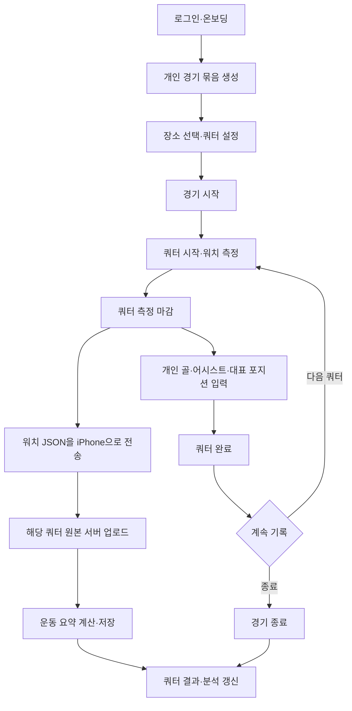

# KIIKICK iOS·watchOS 통합 기능 명세

**v0.4 · 2026-11-02 · 사용자 피드백 반영**

현재 기준은 각자 자신의 경기·쿼터를 기록하는 개인 운동 기록 서비스다. 아래 확정 사항은 이 대화에서 사용자가 정한 내용이며 이전 공유 경기·팀 점수 중심 해석을 대체한다. 문서 수정은 구현 완료를 의미하지 않는다.

## 1. 확정된 기록 구조

- `quarters`가 실제 기록 단위다. `matches`는 같은 경기의 날짜·장소와 쿼터 목록을 묶는다. 각 쿼터는 `match_id`로 경기 묶음을 가리킨다.
- 경기 소유자 한 명이 곧 기록 대상이다. 경기 참가자 등록, 타인 대신 기록, 팀 배정·홈/어웨이 점수는 없다.
- 골·어시스트는 쿼터별 개인 합계를 직접 저장한다. #115의 운동 원본에는 goal/assist 발생 위치·시각을 보존하지만 합계를 자동 변경하거나 이벤트 수정 이력을 만들지 않는다.
- 포지션은 쿼터마다 대표 하나만 저장한다. 정확한 코드 목록과 입력 의무는 P05 검토 대상이다.
- 운동 측정은 쿼터별이다. Watch가 보낸 GPS·심박 원본 전체를 서버에 보존한다. 쿼터당 운동 원본 한 건은 현재 설계 가정이며 중단/재측정 처리 정책은 P10에서 정한다.
- 경기장은 개인 저장 목록으로 유지하여 재사용한다.
- 운동 요약은 업로드 또는 명시적 재계산 시 계산해 저장한다. 일반 조회에서 원본 전체를 반복 계산하지 않는다. 별도 경기 결과 집계 상태·발행 대기 테이블은 없다.
- TRIMP는 Edwards 방식 하나를 사용한다. 결과와 계산에 사용한 개인 기준 최대심박수를 저장한다. 심박 Zone별 체류 시간은 중간 계산으로만 사용한다.

## 2. 화면·동작

| 화면 | 동작 | 데이터 기준 |
| --- | --- | --- |
| 인증·온보딩·마이페이지 | 로그인·프로필·동의·탈퇴 | 본인 사용자 |
| 경기 세팅 | 장소 재사용, 개인 경기 묶음 생성, 쿼터 시간 설정 | matches, quarters, venues |
| 쿼터 진행 | 시작·마감, 골·어시스트 합계 입력, 포지션 하나 입력, 완료 | 본인 쿼터 |
| 홈 | 준비/진행 경기, 최근 완료 경기와 쿼터 요약 | iOS에서 본인 경기·결과 API를 조합 |
| 쿼터 결과 | 골·어시스트·포지션·운동 지표·경로·심박 그래프 | quarter_id |
| 경기 결과 | 소속 쿼터 목록과 개인 합계 | 쿼터 원본 및 저장 요약 |
| 친구 | 검색·요청·수락·해제·차단, 공개 프로필, 친구 경기 조회·댓글 | 개인 기록 소유권과 분리 |
| 분석 | 기간 통계·추이·이전 경기 비교·포지션 분포·친구 비교 | 완료 쿼터와 저장 요약 |
| 알림 | 목록·읽음·접근 가능한 대상 이동 | 수신자 본인과 현재 권한 |

친구의 결과를 알리는 기능의 트리거·공개 범위는 P09 미확정이다. 수락된 친구는 친구 전용 경로로 경기·쿼터 결과를 조회하고 댓글을 주고받는다. GPS·심박 원본 샘플과 경기 수정은 소유자 전용이다. 함께 경기한 사용자를 자동으로 식별하는 구조는 현재 범위에 없다.

## 3. 쿼터 운동 지표

| 지표 | 단위·처리 |
| --- | --- |
| 최고속도 / 평균속력 | m/s. 평균은 계산에 사용한 운동 시간 기준 |
| 이동거리 / 고강도 주행거리 | m. 고강도는 심박 조건과 GPS 구간을 결합 |
| 소모 칼로리 | kcal. iOS 활동 칼로리 누적값 |
| 가속 / 감속 / 방향전환 | 이벤트 횟수. 단순 샘플 개수와 다름 |
| 평균 심박수 / 최고심박수 | bpm. 평균은 유효 시간 가중 |
| Edwards TRIMP | Zone별 체류 시간(분) × 1~5의 합 |

고강도 심박 기준, 가속·감속 임계값, 방향전환 각도/최소 속도, 샘플 누락 처리와 활동 시간 기준은 [P08](decisions.md)에서 정한다. 기준 미확정·입력 부족은 해당 지표를 null과 상태로 표시하며 임의 수치로 채우지 않는다. 세부 산식은 [계산 계약](dbdiagram/quarter-summary.md)을 따른다.

## 4. 사용자 흐름

원본 전송과 쿼터/경기 종료는 독립이다. 경기 종료 후 도착한 측정 파일도 같은 소유자·쿼터에 연결해 수신한다. 서버 업로드 경로는 신규 API 제안이다. 현재 iOS의 Watch → iPhone 파일 전송을 서버 직접 전송으로 바꿨다고 간주하지 않는다.

## 5. 상태와 누락 표시

| 대상 | 상태·의미 |
| --- | --- |
| 개인 경기 | DRAFT → READY → IN_PROGRESS → COMPLETED. 시작 전 CANCELLED 허용 |
| 쿼터 | READY → IN_PROGRESS → COMPLETED |
| 쿼터 측정 마감 | IN_PROGRESS에서 ended_at을 기록하고 개인 기록 입력 단계를 거침 |
| 운동 미수신 | workout/summary=null. 쿼터 완료와 독립 |
| 운동 요약 | PROCESSING / PARTIAL / READY / FAILED. 경기 상태와 독립 |
| 미입력 기록 | stats 또는 position=null. 명시적 goals=0/assists=0과 구별 |

게임 기록과 요약의 차이는 API에도 반영한다. 경기 종료는 즉시 200, 운동 원본 업로드는 원본 저장 201, 요약 GET은 200 안에 계산 상태를 담는다. 사용자에게 데이터가 아직 없는 이유와 재시도/입력 동작을 제공한다.

## 6. 공통 요구사항

- 본인 소유 경기·쿼터를 매 요청 확인한다. 비교 데이터는 친구 관계와 공개 동의를 별도로 확인한다.
- 동일 파일/명령 재전송으로 중복 원본·샘플·횟수를 생성하지 않는다. 골·어시스트는 절대 합계 저장이다.
- 저장된 운동 요약은 원본 해시·계산 버전·기준값과 함께 관리한다. 기준 변경 후 이전 계산이 최신 값을 덮어쓰지 못하게 한다.
- GPS·심박 원본은 수집된 전체를 보존한다. 보존 기간과 탈퇴 시 삭제 범위는 P11에서 정하며 영구 보존을 확정한 것은 아니다.
- 서비스 시간대는 Asia/Seoul이다. 일반 API와 앱 표시는 +09:00 기준, DB 내부는 UTC 저장을 유지한다. iOS 원본 날짜의 Apple epoch 변환을 구별한다.
- 모든 화면에 로딩·빈 상태·오류·재시도를 제공하고 VoiceOver·Dynamic Type·색 외의 상태 구분을 지원한다.
- 목록과 원본 배열은 페이지 조회한다. 위치·심박·토큰 원문은 로그로 남기지 않는다.

## 7. 요구사항 추적

| ID | 기능 | API 문서 | 엔티티 |
| --- | --- | --- | --- |
| F01 | 인증·온보딩 | [auth](api/auth.md) | users, auth_identities, auth_sessions, user_consents |
| F02 | 알림·기기 | [notifications](api/notifications.md) | notifications, devices |
| F03 | 장소·개인 경기·쿼터 설정 | [setup](api/setup.md) | venues, matches, quarters |
| F04 | 쿼터 진행·골·어시스트·포지션 | [gameplay](api/gameplay.md) | quarters, quarter_player_stats, quarter_positions |
| F05 | 홈 | [iOS 홈 화면 연동](api/home.md) | matches, quarters, quarter_summaries |
| F06 | 친구 | [friends](api/friends.md) | friend_pairs, user_blocks, match_comments |
| F07 | 개인 경기·쿼터 결과 | [results](api/results.md) | quarters, quarter_player_stats, quarter_positions, quarter_summaries |
| F08 | 개인 분석·비교 | [analytics](api/analytics.md) | quarter_player_stats, quarter_positions, quarter_summaries |
| F09 | 마이페이지 | [auth](api/auth.md) | users, user_consents |
| F10 | 워치 측정·서버 업로드·선택적 명령 큐 | [workouts](api/workouts.md), [watch](api/watch.md) | workout_payloads, track_points, heart_rate_samples, sync_operations |

## 8. 기존 자료와 확인 범위

아래 Notion 상세 본문은 확인하지 못했다. 이전 유저 플로우의 팀 점수·공유 경기 해석은 사용자 확정에 따라 이 문서로 대체한다. 미확인 원문 내용을 현재 확정 요구사항처럼 추가하지 않는다.

| 절 | 원본 링크 | 확인 상태 |
| --- | --- | --- |
| 3.1 인증/온보딩 | [Notion](https://app.notion.com/p/4072869092af8011b0d3cd89d2d672de?pvs=21) | 본문 접근 불가 |
| 3.2 알림 | [Notion](https://app.notion.com/p/4072869092af80c7ad91e4990f6ae619?pvs=21) | 본문 접근 불가 |
| 3.3 경기 세팅하기 | [Notion](https://app.notion.com/p/4072869092af808181f7ee63a06b8517?pvs=21) | 본문 접근 불가 |
| 3.4 경기 진행 및 실시간 기록 | [Notion](https://app.notion.com/p/4072869092af80df991fe20b2932e78c?pvs=21) | 본문 접근 불가 |
| 3.5 홈 | [Notion](https://app.notion.com/p/4072869092af8083a566d6ec6c7903d2?pvs=21) | 본문 접근 불가 |
| 3.6 친구 | [Notion](https://app.notion.com/p/4072869092af80f89a03e234c8286910?pvs=21) | 본문 접근 불가 |
| 3.7 경기 결과 | [Notion](https://app.notion.com/p/4072869092af807d9f95c618af9c12a9?pvs=21) | 본문 접근 불가 |
| 3.8 분석 | [Notion](https://app.notion.com/p/4072869092af802eb151e8e000ed951d?pvs=21) | 본문 접근 불가 |
| 3.9 마이페이지 | [Notion](https://app.notion.com/p/4072869092af805aa1ade1a1b3270b67?pvs=21) | 본문 접근 불가 |
| 3.10 watchOS | [Notion](https://app.notion.com/p/4072869092af80d5bd3ac7bcf5e347a3?pvs=21) | 본문 접근 불가 |

운동 필드는 [iOS WorkoutPayload DTO](https://github.com/DeveloperAcademy-POSTECH/2026-C6-A03-KIIKICK-iOS/blob/main/docs/dto/workout-payload.md)에 맞춘다. 기능·API·ERD는 모두 v0.4 제안이며 실제 서버 적용은 별도다.
